<p align="center">
  <picture>
    <source media="(prefers-color-scheme: dark)" srcset="docs/assets/kubri-logo-dark.svg">
    
  </picture>
</p>

<p align="center">
  <b>A fast Kubernetes GUI that does everything k9s does, by keyboard or by mouse.</b><br>
  A desktop app for Windows, macOS and Linux, or a web app for your whole team.
</p>

<p align="center">
  <a href="https://github.com/snaketech-tu/kubri/actions/workflows/ci.yml"></a>
  <a href="LICENSE"></a>
  
</p>

<p align="center">
  <a href="#install">Install</a> ·
  <a href="#features">Features</a> ·
  <a href="#screenshots">Screenshots</a> ·
  <a href="#coming-from-k9s">Coming from k9s</a> ·
  <a href="#documentation">Docs</a>
</p>

<picture>
  <source media="(prefers-color-scheme: dark)" srcset="docs/assets/screenshots/pods-dark.png">
  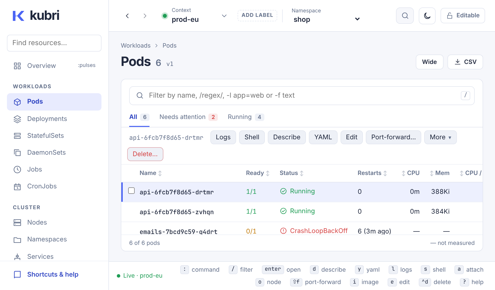
</picture>

## Why Kubri

<table>
  <tr>
    <td width="33%" valign="top"><b>Everything k9s does</b><br>Every resource and CRD, live. Drill-downs, logs, shells, port-forwards, Pulses, XRay, RBAC, Helm, a sanitizer and benchmarks. Your k9s aliases, hotkeys, plugins and skins work as they are.</td>
    <td width="33%" valign="top"><b>Keyboard or mouse</b><br>The keys are the ones you know from k9s, <kbd>:</kbd> opens the command palette and <kbd>?</kbd> lists them all. Or click: every action is a button, and a right click on a row lists everything you can do with it, with its key.</td>
    <td width="33%" valign="top"><b>Desktop or browser</b><br>A small native app built with Rust and Tauri, one container for your team with a password sign-in, or a pod in the cluster with its service account.</td>
  </tr>
</table>

## Install

### Desktop app

Download it for Windows, macOS or Linux from the [releases](https://github.com/snaketech-tu/kubri/releases). It uses the kubeconfig on your computer, just like kubectl.

### In the browser

```sh
docker run --rm -p 127.0.0.1:7878:7878 \
  --user "$(id -u)" \
  -v "$HOME/.kube/config:/kubeconfig:ro" -e KUBECONFIG=/kubeconfig \
  -e KUBRI_PASSWORD='a long password' \
  ghcr.io/snaketech-tu/kubri
```

Then open <http://127.0.0.1:7878>. To run it in a cluster for your team, with [`deploy/kubernetes.yaml`](deploy/kubernetes.yaml), see [Running Kubri in the browser](docs/WEB.md).

### From source

See [Development](#development).

## Features

<table>
  <tr>
    <td width="50%" valign="top">
      <b>Browse</b>
      <ul>
        <li>Every resource type and CRD, live, with the columns of <code>kubectl get</code> (<kbd>w</kbd> for the wide view)</li>
        <li>k9s filters: regular expressions, <code>!</code> to invert, <code>-f</code> fuzzy, <code>-l app=web</code></li>
        <li><kbd>Enter</kbd> drills down, <kbd>Shift</kbd>+<kbd>J</kbd> jumps to the owner, <kbd>[</kbd> <kbd>]</kbd> go back and forth</li>
        <li>CPU and memory against requests, limits and node capacity</li>
      </ul>
    </td>
    <td width="50%" valign="top">
      <b>Act</b>
      <ul>
        <li>Delete, scale, restart, set images and roll back</li>
        <li>Edit YAML, labels and annotations</li>
        <li>Run and suspend CronJobs</li>
        <li>Cordon, uncordon and drain nodes with the checks of <code>kubectl drain</code></li>
      </ul>
    </td>
  </tr>
  <tr>
    <td valign="top">
      <b>Debug</b>
      <ul>
        <li>Live logs of a pod or a whole workload, all containers merged, with new pods joining during a rollout</li>
        <li>Levels, JSON and logfmt fields as a table, field filters like <code>status>=500</code>, folded stack traces and a rate strip</li>
        <li>Shell or attach in a real terminal</li>
        <li>A workspace of log and shell tabs that keep running while you browse, docked below or beside the list, two side by side</li>
        <li>Port-forwards, with HTTP benchmarks on top</li>
        <li>Decoded Secrets, and what uses a ConfigMap or Secret</li>
      </ul>
    </td>
    <td valign="top">
      <b>See the whole cluster</b>
      <ul>
        <li>Pulses: health per kind, usage trends and recent warnings</li>
        <li>XRay: each workload down to its pods, containers and references</li>
        <li>RBAC: who may do what, as a matrix of verbs</li>
        <li>Helm releases, and a Popeye-style sanitizer with a grade</li>
      </ul>
    </td>
  </tr>
  <tr>
    <td valign="top">
      <b>Work safely</b>
      <ul>
        <li>A name, color and label per context; production shows a banner and asks for the name before deleting</li>
        <li>Read-only and locked contexts, unlocked for 15 minutes when needed</li>
        <li>Actions you may not run say which permission is missing, with a Role to send to an admin</li>
        <li>Every action as the <code>kubectl</code> command that does the same</li>
      </ul>
    </td>
    <td valign="top">
      <b>Edit with confidence</b>
      <ul>
        <li>Changes run as a server-side dry run first and show what would change</li>
        <li>Field docs, completion and checks in the YAML editor, from the cluster's own schema</li>
        <li>Changes others make while you edit are merged with yours, not lost</li>
      </ul>
    </td>
  </tr>
  <tr>
    <td valign="top">
      <b>Your k9s setup</b>
      <ul>
        <li>Aliases, hotkeys, plugins, skins and jumps work as they are</li>
        <li><code>readOnly</code>, <code>defaultView</code>, thresholds and log settings, per context</li>
      </ul>
    </td>
    <td valign="top">
      <b>Run it anywhere</b>
      <ul>
        <li>Desktop app for Windows, macOS and Linux</li>
        <li>In the browser with a password sign-in, from Docker or in the cluster</li>
        <li>A read-only mode that never changes the cluster</li>
        <li>An MCP server, so AI agents can read your clusters with your permissions</li>
        <li>Explain: ask your own model why a pod fails, seeing first what is sent</li>
      </ul>
    </td>
  </tr>
</table>

## Screenshots

<table>
  <tr>
    <td width="50%" valign="top">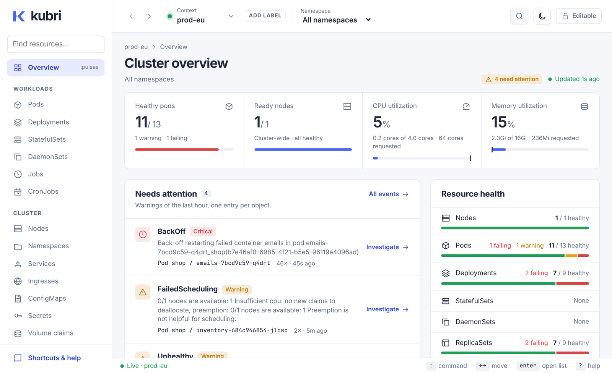<br><b>Overview</b>: what needs attention first, with health and trends (<kbd>:pulses</kbd>)</td>
    <td width="50%" valign="top">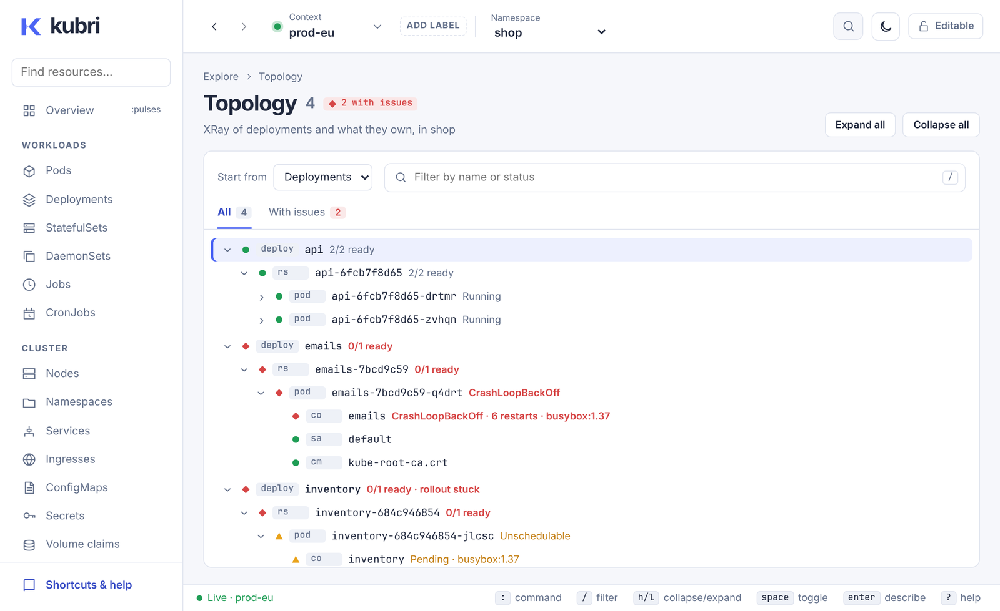<br><b>Topology</b>: from a Deployment down to its pods (<kbd>:xray</kbd>)</td>
  </tr>
  <tr>
    <td valign="top">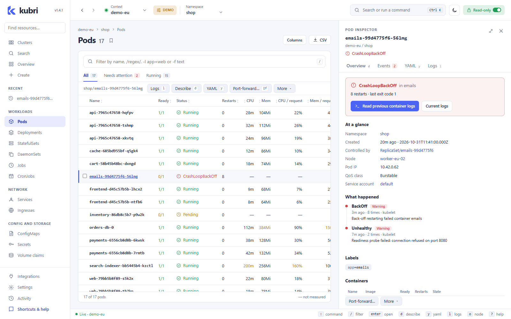<br><b>Inspector</b>: status, the likely problem, events and previous logs beside the list</td>
    <td valign="top">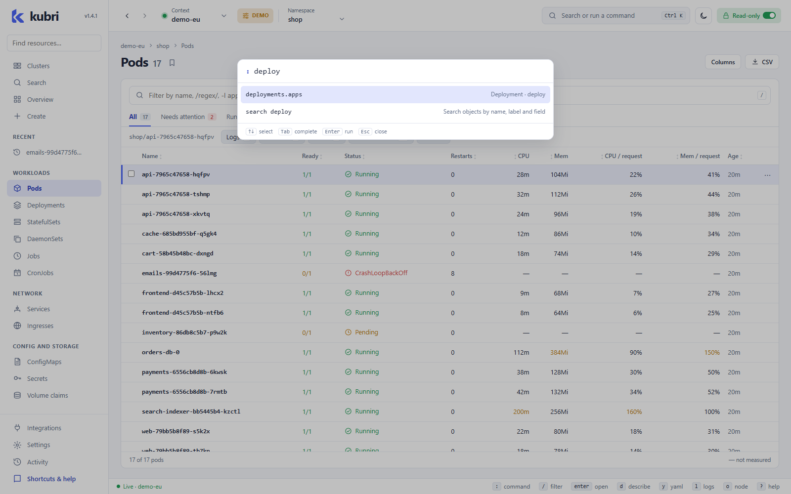<br><b>Command palette</b>: <kbd>:</kbd> and any resource or command</td>
  </tr>
  <tr>
    <td valign="top">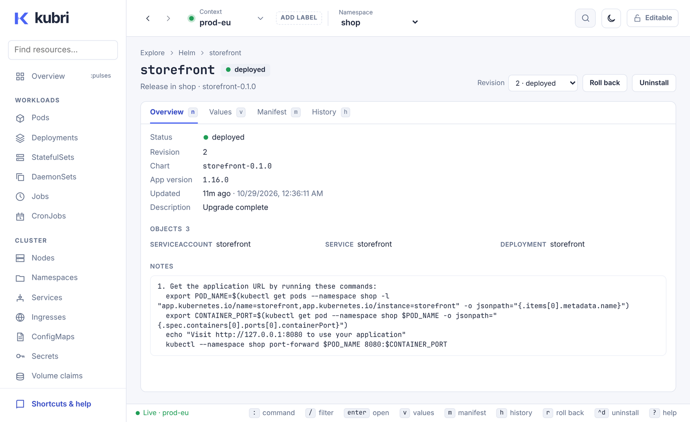<br><b>Helm</b>: releases, values, manifests, history and rollback</td>
    <td valign="top">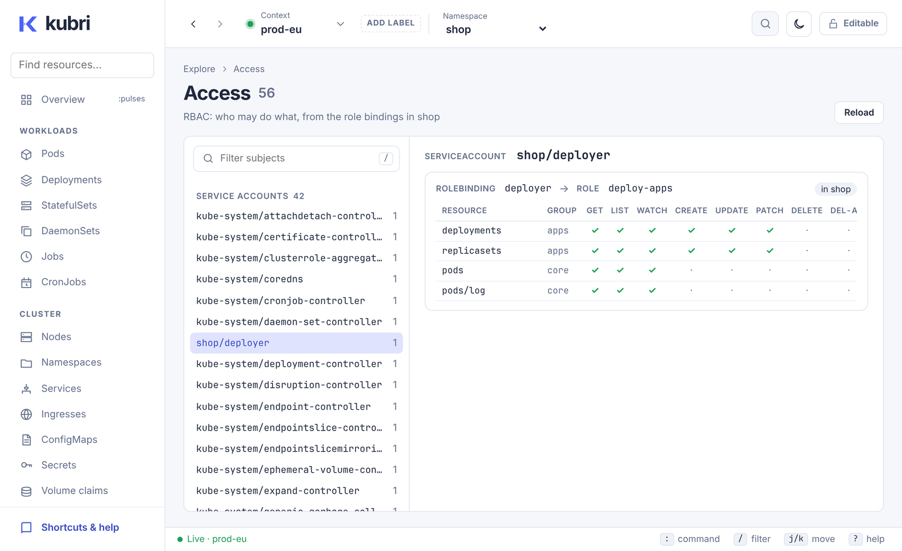<br><b>Access</b>: who may do what, from the role bindings (<kbd>:rbac</kbd>)</td>
  </tr>
  <tr>
    <td valign="top">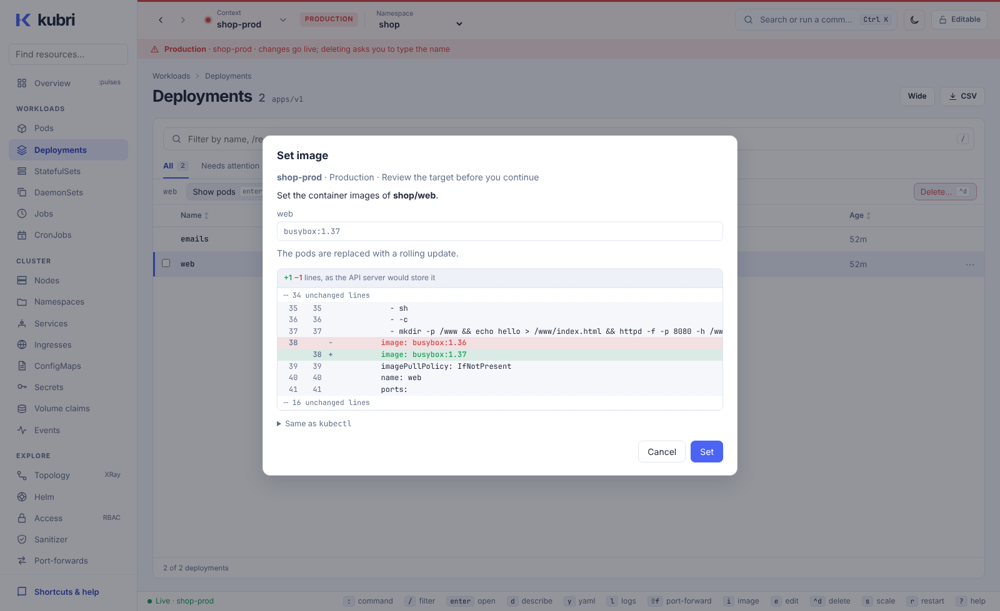<br><b>Production guard rails</b>: a colored context, and every change as a dry-run diff first</td>
    <td valign="top">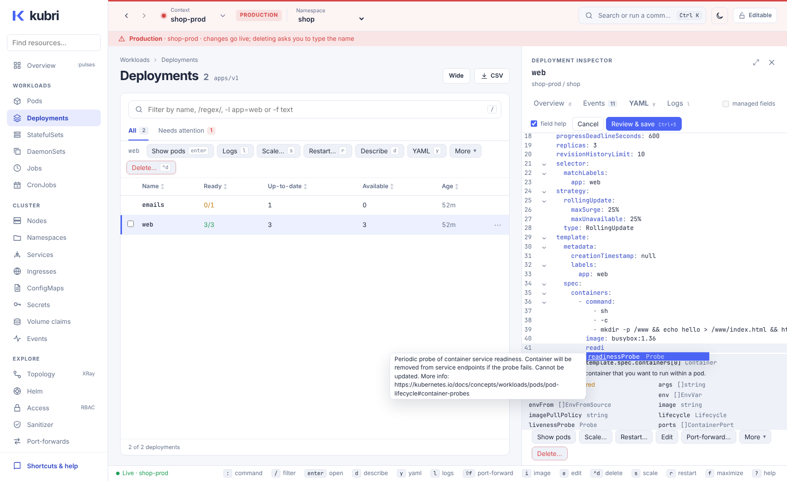<br><b>YAML editor</b>: completion and field docs, like <code>kubectl explain</code></td>
  </tr>
  <tr>
    <td valign="top">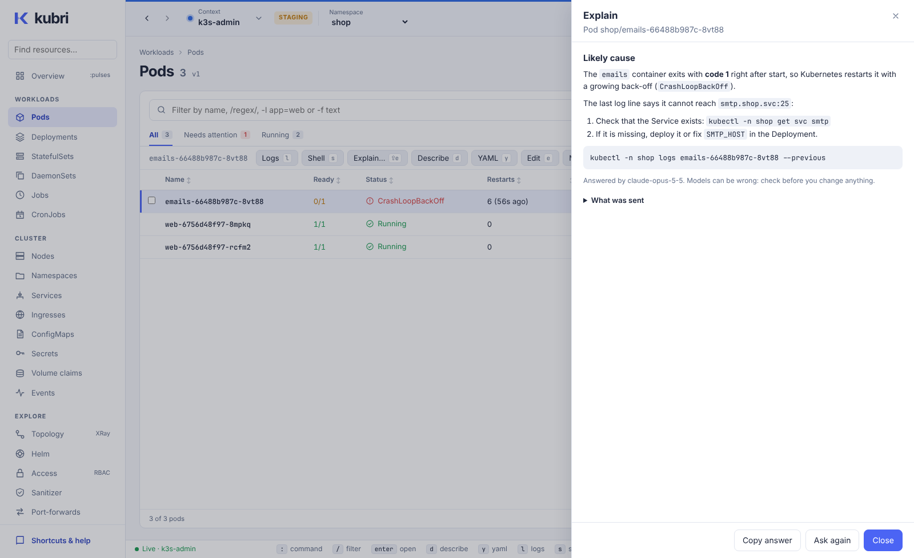<br><b>Explain</b>: ask your own model why a pod fails, after seeing what is sent</td>
    <td valign="top">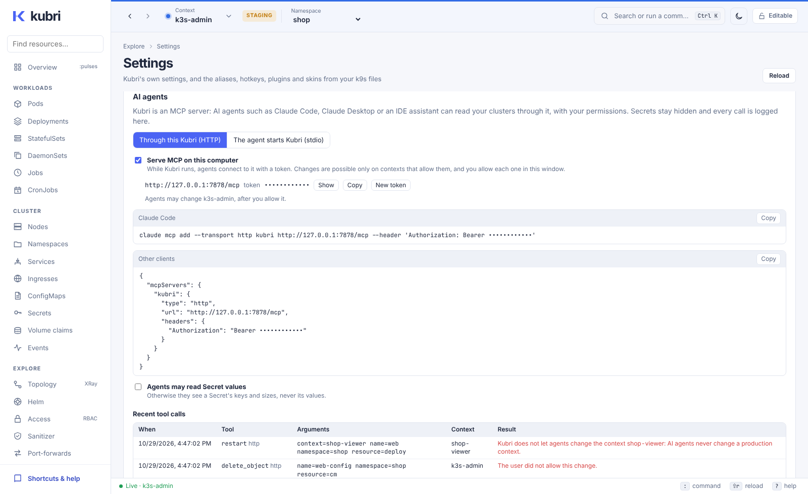<br><b>AI agents</b>: Kubri as an MCP server, with every call logged (<kbd>:agents</kbd>)</td>
  </tr>
</table>

## Coming from k9s

Kubri reads your k9s configuration and uses the same keys, so you can start right away. The ones you will use most:

| Key | What it does |
| --- | --- |
| <kbd>:</kbd> | Go to a resource or run a command, like `:deploy kube-system`, `:po shop app=web` or `:ctx prod` |
| <kbd>/</kbd> | Filter the list |
| <kbd>Enter</kbd> | Drill down, from a Deployment to its pods |
| <kbd>d</kbd> <kbd>y</kbd> <kbd>e</kbd> | Describe, YAML, edit |
| <kbd>l</kbd> <kbd>s</kbd> | Logs, shell |
| <kbd>Shift</kbd>+<kbd>F</kbd> | Port-forward |
| <kbd>Ctrl</kbd>+<kbd>D</kbd> | Delete |
| <kbd>?</kbd> | All keys |

[Using your k9s configuration](docs/K9S.md) lists what Kubri covers and what it does not.

## How it works

Kubri uses the kubeconfig you already have: every file listed in `KUBECONFIG`, or `~/.kube/config` if that is not set. It reads them as kubectl does: listed files that do not exist are skipped, and a context works in Kubri when it works with kubectl, with kubectl's error message when it does not. It connects to your `current-context` on startup, and you can switch contexts at any time from the top bar (or with <kbd>Ctrl</kbd>+<kbd>Shift</kbd>+<kbd>C</kbd>). Started from the Dock, Finder or a desktop launcher, the desktop app takes the environment of your login shell, such as `PATH` and `KUBECONFIG`, so `helm`, credential plugins such as `aws` or `gke-gcloud-auth-plugin`, and the commands of k9s plugins are found as in a terminal.

| Part | Path | What it is |
| --- | --- | --- |
| Core | [`crates/kubri-core`](crates/kubri-core) | All Kubernetes access, built on [kube-rs](https://kube.rs). Shared by both apps. |
| Web server | [`crates/kubri-server`](crates/kubri-server) | Serves the UI and a REST + WebSocket API on `127.0.0.1:7878`. |
| Desktop app | [`ui/src-tauri`](ui/src-tauri) | [Tauri 2](https://tauri.app) shell that calls the core directly. |
| UI | [`ui`](ui) | SvelteKit + TypeScript single-page app, used by both. |

## Documentation

- [Running Kubri in the browser](docs/WEB.md): settings, sign-in, the Docker image, running it in a cluster and behind a proxy.
- [AI agents (MCP)](docs/AGENTS.md): connecting Claude Code, Claude Desktop or another agent, the tools it gets, and what it may not do.
- [Explain](docs/EXPLAIN.md): asking a model about a pod, logs, a finding or a failed action with your own key, and what is hidden.
- [Settings and guard rails](docs/SETTINGS.md): context names and colors, production and read-only contexts, permissions, dry-run diffs and the YAML editor.
- [Using your k9s configuration](docs/K9S.md): what Kubri reads from k9s, and what it covers.
- [Releasing](docs/RELEASING.md): how a version is published.
- [Roadmap](docs/ROADMAP.md): the steps toward k9s parity and what each one covered.
- [Kubri and Headlamp](docs/HEADLAMP-COMPARISON.md): where Headlamp does better today, and what to adopt.
- [Ideas](docs/IDEAS.md): how Kubri could go beyond Headlamp, and what neither tool has yet.

## Development

<details>
<summary>Build, run and test Kubri from source</summary>

You need Rust (stable), Node.js 22 and pnpm. On Linux the desktop app also needs the [Tauri system dependencies](https://tauri.app/start/prerequisites/).

```sh
cd ui && pnpm install

# Desktop app with hot reload
pnpm tauri dev

# Browser: run the server and the Vite dev server (which proxies /api to it)
cargo run -p kubri-server      # from the repository root
pnpm dev                       # in ui/, then open http://localhost:5173
```

To serve a production build in the browser, run `pnpm build` in `ui/`, then `cargo run --release -p kubri-server` from the repository root and open <http://127.0.0.1:7878>. On localhost it asks for no password; on other addresses it does. [Running Kubri in the browser](docs/WEB.md) has the settings, the Docker image and how to run it in a cluster.

`docker build -t kubri .` builds the image. [Releasing](docs/RELEASING.md) describes how a version is published.

Checks that CI runs:

```sh
cargo fmt --check && cargo clippy --all-targets -- -D warnings && cargo test
cd ui && pnpm check && pnpm test
```

</details>

## License

Kubri is licensed under the [Apache License 2.0](LICENSE).
